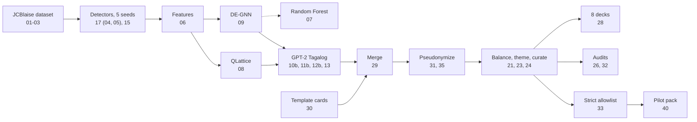

# M.I.N.E.R.V.A.

**M**isinformation **I**nvestigation through **N**etworked **E**mbeddings for **R**umor **V**erification and **A**wareness

[](CHANGELOG.md)
[](requirements.txt)
[](https://colab.research.google.com/github/robertgeraldsenasin/MINERVA/blob/main/notebooks/MINERVA_Run_Colab.ipynb)

This repository holds the detection, scoring and content pipeline behind M.I.N.E.R.V.A., an educational electoral rumor detection simulator that helps Filipino senior high school (SHS) students build misinformation literacy. The pipeline trains Tagalog fake-news detectors, fits an interpretable QLattice scoring equation, generates fictional election posts with GPT-2, and curates them into the card decks the Android game plays.

> **Release v2.9.9** is the version presented at the **FEU Tech Student Research Colloquium 2026** and at **CS Expo 2026**.
> B.S. Computer Science with specialization in Software Engineering thesis, FEU Institute of Technology.

## Contents

- [The study](#the-study)
- [What this repository contains](#what-this-repository-contains)
- [How the pipeline works](#how-the-pipeline-works)
- [Results of the release run](#results-of-the-release-run)
- [Evaluation with students and experts](#evaluation-with-students-and-experts)
- [Quick start](#quick-start)
- [Repository layout](#repository-layout)
- [Reproducibility](#reproducibility)
- [Versions](#versions)
- [Citation](#citation)
- [Team and acknowledgements](#team-and-acknowledgements)

## The study

M.I.N.E.R.V.A. pairs an explainable credibility engine with a gamified, fictional social-media feed. The study has four objectives:

1. **Detect.** Label and score posts with a hybrid pipeline: two transformer detectors, a Dual-Embedding Graph Neural Network (DE-GNN) and a Random Forest decision layer.
2. **Explain.** Turn the score into a closed-form QLattice equation, and give learners reasons through a rule layer of 12 named misinformation indicators tied to SIFT verification moves.
3. **Play.** Deliver the cards in a Unity Android game: players read posts in **Chattr** (Trust, Report or Ignore), see consequences in **VERIdex**, and get the verdict, the fired cues and the explanation in **VERIdict**.
4. **Evaluate.** Test the engine, the students' acceptance and accuracy, and expert-rated software quality (ISO/IEC 25010).

All posts in the game are fictional. Real people are replaced by Candidate A, B and C, and real places by placeholders such as City W and Province L.

## What this repository contains

| Included | Not included |
|---|---|
| Detector training (RoBERTa-Tagalog, multilingual DistilBERT), feature extraction, DE-GNN, Random Forest and QLattice scripts | The Unity Android game |
| GPT-2 Tagalog generation, template cards, pseudonymization, curation, safety audits and deck drawing | Run outputs (`data/`, `models/`, `generated/`, `reports/` are created when the pipeline runs) |
| The Colab notebook of the release run, with its printed output | Survey and expert-evaluation responses |
| Unit tests and documentation | |

## How the pipeline works



The dashed arrow marks the Random Forest, which runs as a separate step. The stages:

| Stage | Scripts | What it does |
|---|---|---|
| Data | `01`, `02`, `03` | Downloads `jcblaise/fake_news_filipino`, normalizes it and makes a stratified 70/15/15 split |
| Detectors | `17` (runs `04`, `05`), `export_best_detectors_by_val.py`, `15` | Fine-tunes `jcblaise/roberta-tagalog-base` and `distilbert-base-multilingual-cased` on five seeds, exports the best seed by validation F1 and evaluates it on the test split |
| Features | `06` | 16 PCA components of each detector's embeddings, both detectors' fake probabilities and five surface features (39 columns) |
| QLattice | `08` | Symbolic regression to a closed-form logistic equation (`models/qlattice_equation.txt`); falls back to scikit-learn logistic regression if `feyn` is missing |
| DE-GNN | `09` | GraphSAGE over a cosine k-nearest-neighbour graph (k = 10) of the dual-embedding features |
| Random Forest | `07` | Random Forest on the tabular features plus the DE-GNN probability |
| GPT-2 | `10b`, `11b`, `12b`, `13` | Builds a control-token corpus, fine-tunes `jcblaise/gpt2-tagalog`, generates fake and real posts, and scores them |
| Templates | `30` | 18 scenario templates expanded into 900 cards |
| Merge | `29` | Adds GPT-2 posts that pass the length and truncation checks, mention at most three distinct entities, reference a fictional candidate and have response-bank coverage for their indicators |
| Pseudonymize | `31`, `35` | Replaces real people and real places |
| Curate | `21`, `23`, `24` | Balances verdicts and candidates (700 cards, schema-validated), keeps on-theme election cards and builds the teaching pool |
| Decks | `28` | Draws eight 56-card decks (7 in-game days × 8 cards) |
| Audits | `26`, `32` | Explanation-consistency audit; consistency check of the stored detector scores |
| Allowlist | `33` | Rejects cards that contain a blocklisted real name or any name not on the allowlist, and writes `generated/unity_cards_pool_strict.json` |
| Pilot pack | `40` | A 30-card pack stratified by verdict, tier, candidate and tactic |

Method details are in [`docs/CODEBOOK.md`](docs/CODEBOOK.md) and [`docs/architecture.md`](docs/architecture.md).

## Results of the release run

Release v2.9.9, run on 15 May 2026 (run ID `v28_panel`, `full_retrain` mode, NVIDIA A100 80 GB). All figures below are printed in [`notebooks/MINERVA_Run_Colab.ipynb`](notebooks/MINERVA_Run_Colab.ipynb) or written to its reports.

### Data

| | Count |
|---|---|
| Rows downloaded | 3,206 |
| Rows after normalization | 3,005 (1,496 real, 1,509 fake) |
| Train / validation / test | 2,103 / 451 / 451 |

### Detection and scoring

| Model | Test-split result |
|---|---|
| RoBERTa-Tagalog, mean of 5 seeds | F1 94.82% (SD 1.21) |
| DistilBERT multilingual, mean of 5 seeds | F1 91.73% (SD 0.65) |
| RoBERTa-Tagalog vs DistilBERT | paired *t*(4) = 3.961, *p* = .0167 |
| Exported RoBERTa-Tagalog checkpoint (seed 127) | F1 95.96% |
| Exported DistilBERT checkpoint (seed 47) | F1 91.47% |
| DE-GNN (single seed) | F1 94.55%, precision 97.20%, recall 92.04%, accuracy 94.68% |

The QLattice equation, fitted on the 2,103 training rows and 39 features:

```
P(fake) = logreg(9.11136·p_roberta_fake + 2.43479·p_distil_fake + 0.555212·d_pca_4 − 0.385122·r_pca_5 − 5.88038)
```

### Content and safety

| Stage | Result |
|---|---|
| Template cards | 900 |
| GPT-2 posts reaching the merge | 839 of 1,000 generated (421 fake, 418 real) |
| GPT-2 posts promoted | 525 (259 fake, 266 real); 314 rejected (295 over the entity limit, 19 without a candidate) |
| Names replaced | 1,061, in 397 GPT-2 cards |
| Places replaced | 370, in 207 cards |
| Election-theme filter | 663 of 700 kept (17 off-theme, 17 without a candidate, 3 truncated) |
| Curated pool | 663 cards: 437 FAKE, 118 UNCERTAIN, 108 REAL; 565 template and 98 GPT-2; all 12 indicators covered |
| Explanation-consistency audit | 663 of 663 passed |
| Strict allowlist | 653 of 663 kept (98.49%); the 10 rejected cards include one blocklist match for a real politician's surname |
| Decks | 8 × 56 cards; mean pairwise overlap 12.05% (3.57% to 19.64%) |
| Unit tests | 325 passed |

## Evaluation with students and experts

These results come from the thesis manuscript (Chapter 4). The response data are not in this repository.

| Instrument | Respondents | Result |
|---|---|---|
| ISO/IEC 25010 expert evaluation | 15 evaluators | Overall 4.53 (Strongly Agree): Functional Suitability 4.62, Performance Efficiency 4.56, Security 4.53, Reliability 4.47, Usability 4.46. 10 of 15 rated the build Beta or higher. |
| Technology Acceptance Model | 50 SHS students, after gameplay | Overall 4.20: Perceived Usefulness 4.30, Attitude 4.27, Perceived Ease of Use 4.13, Behavioral Intention 4.08 |
| Post classification | 50 students before and 50 after gameplay | 70.40% correct before, 79.60% after. The samples were not matched and the posts differ, so this is a descriptive comparison. |

## Quick start

### Run the tests (no GPU)

```bash
git clone https://github.com/robertgeraldsenasin/MINERVA.git
cd MINERVA
python -m venv .venv
source .venv/bin/activate          # Windows PowerShell: .\.venv\Scripts\Activate.ps1
pip install -r dev-requirements.txt
python -m pytest tests/ -q
```

`dev-requirements.txt` leaves out torch, transformers and feyn, so tests that need them are skipped. Install `requirements.txt` to run the full suite.

### Reproduce the release run on Colab

1. Open the notebook with the **Open in Colab** badge above, or in Colab choose **File → Open notebook → GitHub**, enter `robertgeraldsenasin/MINERVA`, branch `main`, and pick `notebooks/MINERVA_Run_Colab.ipynb`.
2. Choose **Runtime → Change runtime type → A100 GPU** with **High-RAM**.
3. In the configuration cell, keep `PIPELINE_MODE = "full_retrain"` and `USE_GPT2 = True` (the release settings). `templates_only` runs in a few minutes without a GPU; `full_cached` reuses detector artifacts saved in Drive.
4. Choose **Runtime → Run all**. The release run took about an hour on an A100.
5. The last section saves `generated/`, `reports/` and the QLattice equation files to Google Drive (`MINERVA_outputs`), or downloads them as a zip if Drive is off.

Python 3.11 is the tested version (3.10 and 3.12 are supported). `feyn` has no Python 3.13 wheels, so on 3.13 script `08` uses its logistic-regression fallback.

## Repository layout

```
.
├── scripts/
│   ├── 01_…40_*.py                    # 36 pipeline stages, numbered as in the tables above
│   ├── minerva_*.py                   # 9 shared modules (config, schemas, DE-GNN, QLattice, filters, …)
│   ├── candidate_config.py            # fictional Candidate A/B/C profiles
│   ├── export_best_detectors_by_val.py
│   └── legacy/                        # two superseded pseudonymization scripts, kept for reference
├── templates/
│   ├── candidate_profiles_three_candidates.json
│   ├── jcblaise_real_names_blocklist.txt   # real names that must never reach a card
│   ├── places_blocklist.txt                # Philippine places to pseudonymize
│   ├── response_bank_v2.json               # 225 explanation phrases across 75 keys
│   └── holdout_gpt2_labeled.csv / .README.md   # optional, unlabeled 50-card scaffold
├── notebooks/
│   └── MINERVA_Run_Colab.ipynb        # release notebook, with the output of the 15 May 2026 run
├── tests/                             # 23 test files
├── docs/
│   ├── CODEBOOK.md                    # methods and configuration
│   ├── architecture.md                # one-page overview
│   └── HOLDOUT_VALIDATION_STRATEGY.md
├── data/, models/                     # empty; filled when the pipeline runs
├── requirements.txt                   # full pipeline (Colab)
├── dev-requirements.txt               # tests only
├── Makefile                           # make test, make install, make install-dev
└── CHANGELOG.md
```

## Reproducibility

- **Seeds.** Detectors use five prime seeds (13, 29, 47, 89, 127), following the multi-run reporting of Liu et al. (2019); GPT-2 fine-tuning uses seed 1729 instead of the common 42, following Picard (2021); generation uses seeds 13 (fake) and 27 (real).
- **Model selection.** The exported detector checkpoints are chosen on validation F1. Scalers and PCA are fitted on the training split only.
- **Early stopping.** Detector training stops when validation F1 stops improving, and GPT-2 fine-tuning when validation loss does.
- **Environment.** Each run writes `reports/_environment.json` (Python, PyTorch, CUDA, GPU and package versions).
- **Provenance.** The pool hash and run ID are logged in the reports. The release run printed pool hash `fded092b49b1f55e`.

## Versions

**v2.9.9 is the release.** The release run cloned commit `2959c51`; the commits after it add the notebook's printed output and update this README, with no change to the code. The allowlist entries listed under v2.9.10 in [`CHANGELOG.md`](CHANGELOG.md) were already in that commit, and the run is stamped v2.9.9. The changelog has the full history from v2.6.

## Citation

Lola, J. K. P., Salva, A. J. B., Senasin, R. G. A., & Yapchulay, A. C. M. (2026). *M.I.N.E.R.V.A.: An educational electoral rumor detection simulator using symbolic rule engine via DE-GNN and Qlattice symbolic regression for SHS misinformation literacy* [Bachelor's thesis, FEU Institute of Technology].

## Team and acknowledgements

**Boys at the Back**, FEU Institute of Technology: John Kerby P. Lola, Adrian Joseph B. Salva, Robert Gerald A. Senasin and Andrei Collin M. Yapchulay.

Thesis Mentor Dr. Hazel San L. Patilano, Thesis Adviser Elisa V. Malasaga and Internal Co-Adviser Alexander Hernandez.

The project builds on the JCBlaise Filipino fake-news dataset and the RoBERTa-Tagalog and GPT-2 Tagalog models, Hugging Face Transformers, PyTorch, scikit-learn and Abzu's QLattice (`feyn`).

The code is shared for academic use.
